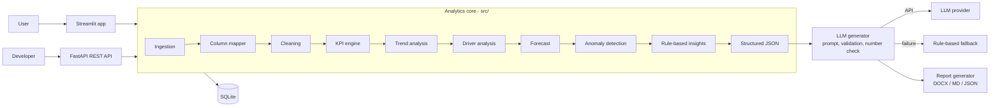
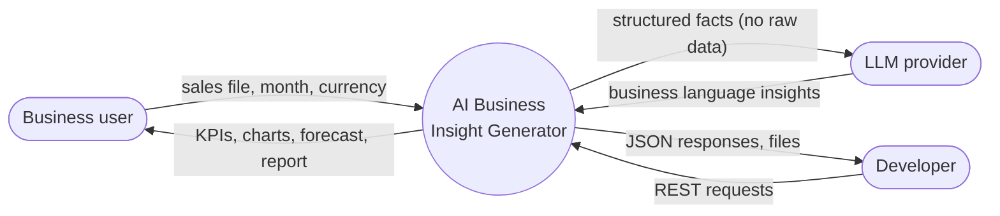
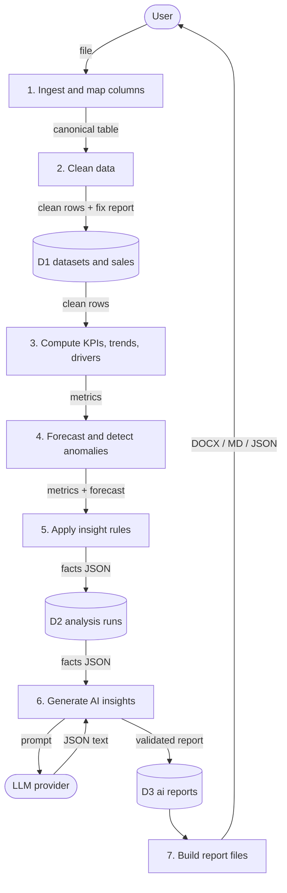
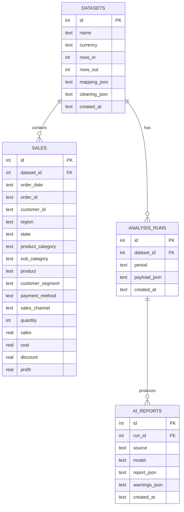
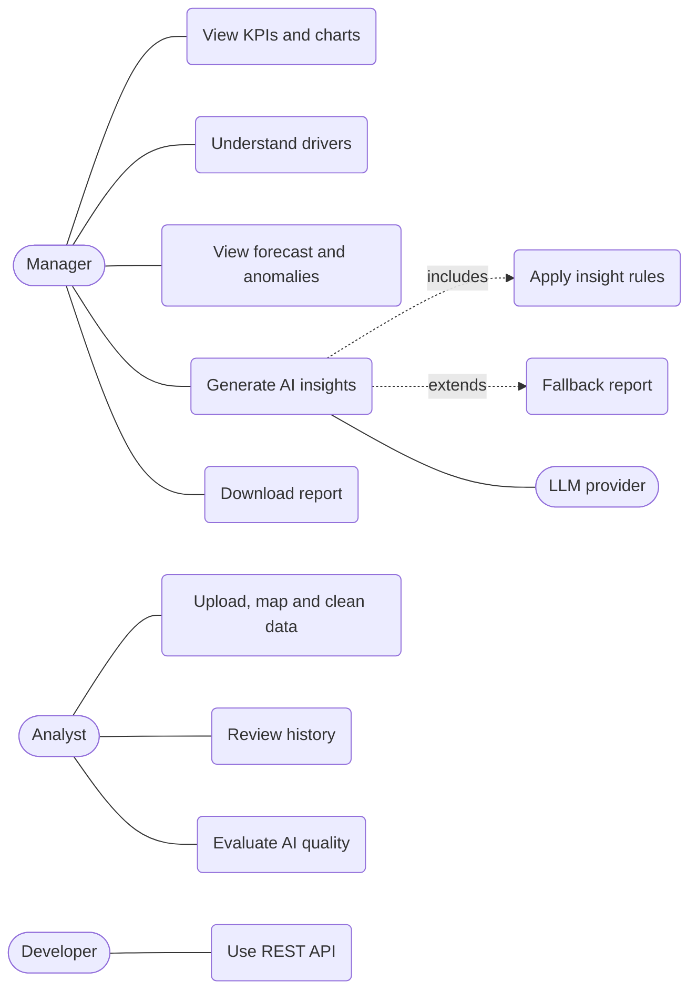
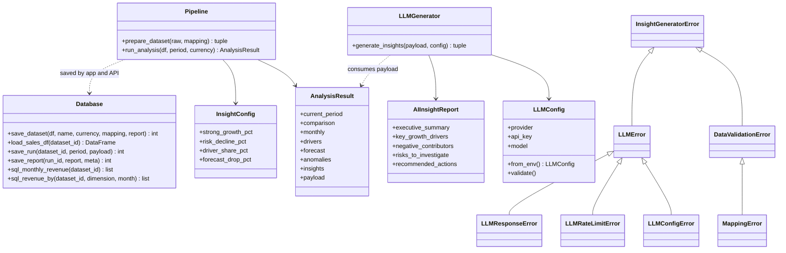
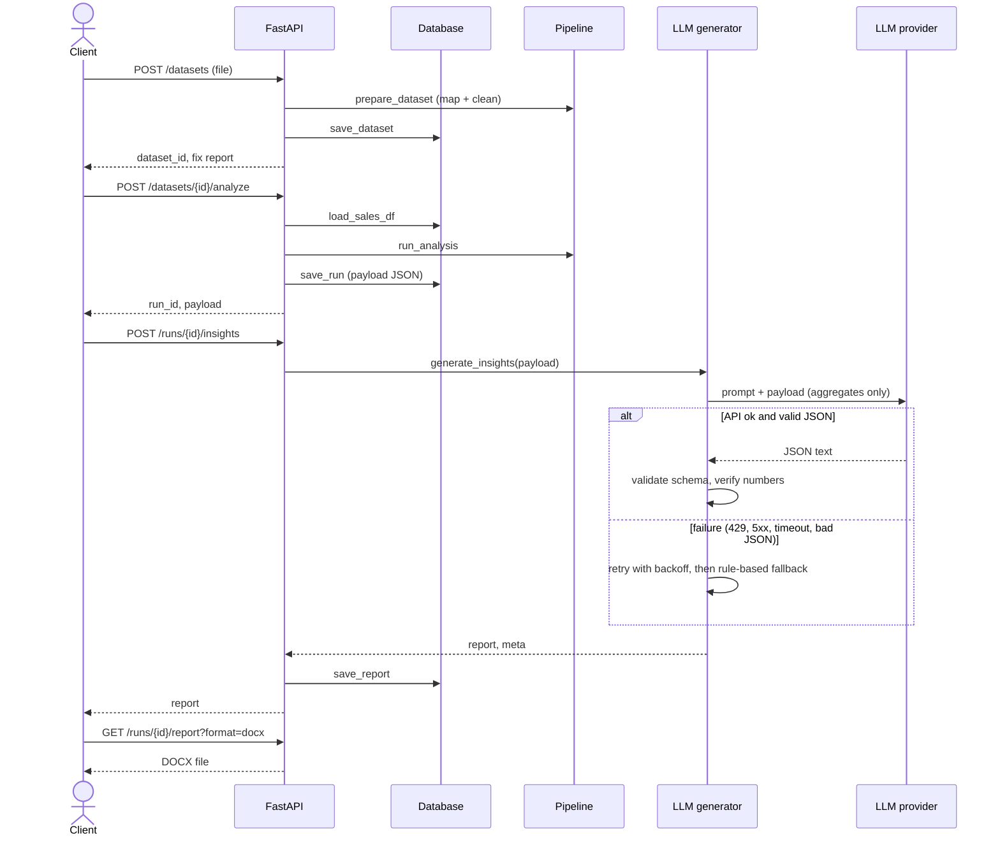
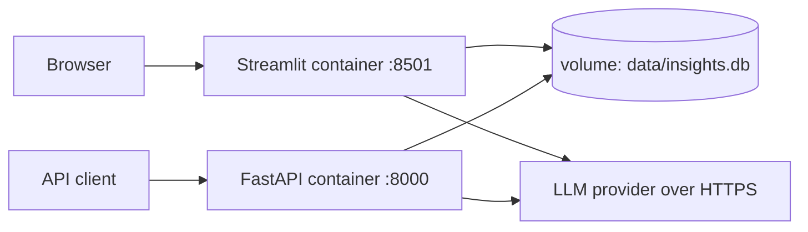

# System Design

Diagrams use [Mermaid](https://mermaid.js.org/). They render automatically on GitHub; in VS Code install the extension "Markdown Preview Mermaid Support"; to export PNG/SVG for your report paste the code into https://mermaid.live.

## 1. Architecture

## 2. Data flow diagrams
### DFD level 0 (context)

### DFD level 1

## 3. Entity-relationship diagram

Indexes: `sales(dataset_id, order_date)`. Deleting a dataset cascades to its sales rows, runs and reports.

## 4. UML use case diagram

## 5. UML class diagram

## 6. Sequence diagram: generate AI insights (API view)

## 7. Module design (src/)
| Module | Responsibility |
|---|---|
| `data_ingestion` | Safe file loading and validation |
| `column_mapper` | Alias/fuzzy column matching, derived columns, mapping checks |
| `data_cleaning` | Types, dates (convention detection), duplicates, invalid values, imputation, outliers |
| `kpi_calculation` | KPIs, comparisons, monthly MoM/YoY, contribution, dimension growth |
| `trend_analysis` | Growth, change/trend classification, period selection |
| `driver_analysis` | Rank contributors by money contribution |
| `forecasting` | Linear and seasonal trend forecast, 95% range, backtest MAPE |
| `anomaly_detection` | Robust z-score (daily) and history z-score (members) |
| `insight_engine` | Configurable IF/THEN rules |
| `schema` | JSON contract between analytics and LLM |
| `llm_generator` | Prompt, REST call, retries, validation, number check, fallback |
| `evaluation` | Hallucination and coverage metrics |
| `report_generator` | DOCX and Markdown reports |
| `database` | SQLite persistence and SQL analytics |
| `pipeline` | Orchestration used by app, API and CLI |

## 8. Key design decisions
1. **Facts first, language last:** all numbers are computed deterministically; the LLM only phrases them.
2. **Money contribution, not percentage, ranks drivers:** a tiny region with +80% can matter less than a large region with +8%.
3. **Order lines, not unique orders:** repeated Order IDs are valid lines of one order, so only exact duplicates are removed.
4. **Unit-price outliers:** judged on price per unit so legitimate bulk orders survive.
5. **Fail soft:** custom exceptions, friendly messages, retry with backoff, rule-based fallback.
6. **Explicit assumptions:** every default, derivation and imputation is written to a notes list shown to the user.

## 9. Deployment

